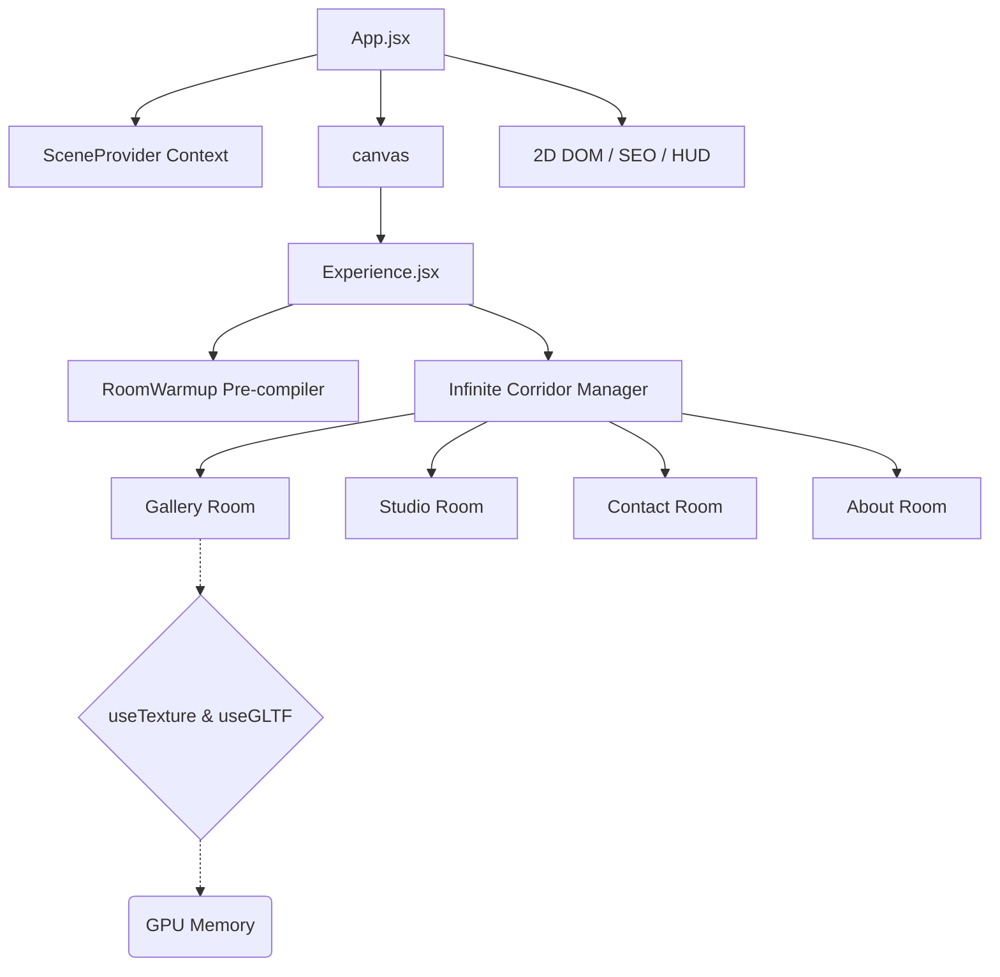

# 此唯 | 3D 可行走作品集世界

<div align="center">
  
  
  
  
  
</div>

<br/>

**此唯（深圳视频导演）的可行走 3D 作品集**：一条无限延伸的走廊，四扇门通往画廊、工作室、关于我与联系方式，作品以卡片墙形式陈列，可行走、可交互、可触发成就。

## 关于本仓库的来历

本项目由 [Tomasz Szmajda (ITom Dev)](https://itomdev.com) 的开源 3D 作品集改造而来，上游代码以 **MIT** 许可发布（见 [LICENSE](LICENSE)，须保留版权声明）。改造范围：

- **身份内容全部替换**：原作者的获奖证书、技能气球、历程岛屿、头像、工作室烘焙贴图等身份资产已移入 `_archive_20261013/`，替换为构建期自绘生成的「此唯」版本（`pipeline/` 脚本）。
- **通用场景素材回收**：墙地门、设备、灯具、地图等中性道具按 MIT 许可复用。
- **数据源本地化**：移除原作者的 Sanity CMS 连接，改为 `src/data/placeholder.ts` → `ciwei-projects.json` 单一真相源（`export-ciwei.mjs` 桥接）。

## 🚀 Key Performance Architectures

1. **Invisible Semantic SEO Fallback:** Bypasses WebGL canvas SEO limitations via strategic `sr-only-seo` indexing DOM injections, rendering fully visible semantic trees to native search-engine crawlers without mounting heavy bundles.
2. **Asynchronous Shader Compilation:** Enforces `gl.compileAsync` during the Preloading phase inside a hidden `RoomWarmup` Suspense boundary. This allows Three.js to pre-compile complex materials asynchronously without blocking the main React update thread.
3. **Baked Global Tinting & Lighting Extraction:** Replaced real-time WebGL shadow maps and infinite light rays with baked-in global textures, dropping the GPU compute overhead entirely while maintaining visual depth.
4. **DOM Mutation Bypassing:** Critical animation properties write directly to `ref.current.style`, intentionally bypassing React's `setState` render cycles to conserve CPU.
5. **Adaptive Device Tiering:** Auto-detects `navigator.deviceMemory`, hardware concurrency, and viewport sizes to scale WebGL resolutions (`dpr`), antialiasing algorithms, and texture loading strictness on the fly.

---

## 🏗️ 3D Scene Architecture



---

## 🛠️ 本地开发

```bash
npm install        # Node.js v20+
npm run dev        # 开发服务器（使用 --host 127.0.0.1）
npm run build      # 生产构建（含构建期资产生成与 SEO 插件）
npm run preview
```

常用脚本：

| 脚本 | 作用 |
| --- | --- |
| `node pipeline/make-balloons.mjs` | 构建期生成技能气球 webp |
| `node pipeline/make-about-art.mjs` | 构建期生成浮岛与云上头像 |
| `node pipeline/make-favicon.mjs` | 构建期生成「此」字 favicon |
| `node scripts/gen-preload-list.mjs` | 扫描 `public/` 重新生成贴图预加载清单 |
| `node export-ciwei.mjs` | 从主站 `placeholder.ts` 导出 `ciwei-projects.json` |

配置见 `src/config/site-config.js`（域名与社交账号单一来源，占位符在 `seo-config.template.md`）。

---

## License

本仓库代码沿用上游的 [MIT License](LICENSE)，版权信息保留于 LICENSE 文件。上游作者的个人形象资产（头像、证书、署名文案）不包含在复用范围内，已由当前创作者替换。
